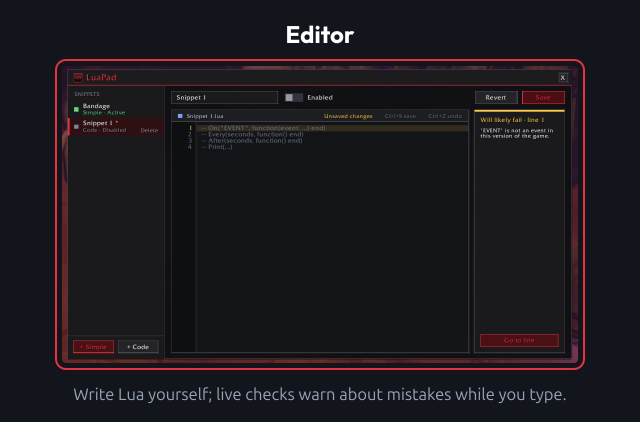
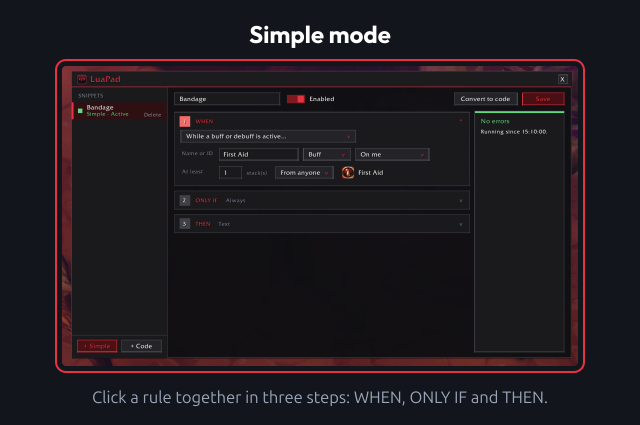
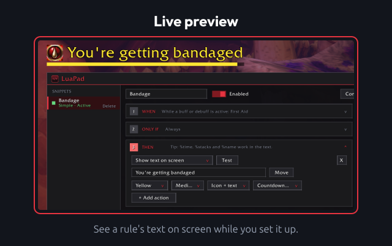
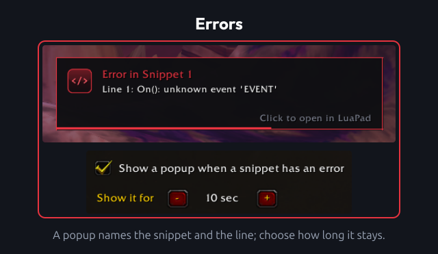

# LuaPad

Paste and run your own Lua snippets in game, with line-accurate error reporting. Or build simple rules without writing any code.

## Usage

### Editor

- `/luapad` or `/lp`: open the editor. Type it again (or press Esc) to close it.
- Drag the title bar to move the window.
- The list on the left holds your snippets. Create a code snippet to write Lua yourself, or a Simple rule to click one together.
- **Save** (or Ctrl+S in the editor) saves the snippet. If it is switched on, it restarts with the new code.
- **Enabled** switches a snippet on or off. Enabled snippets run again after login and `/reload`.
- **Revert** throws away unsaved changes. Ctrl+Z / Ctrl+Y (or Ctrl+Shift+Z) undo and redo.
- **Delete** asks once more before removing a snippet.

### Helpers in every snippet

- `On("EVENT", function(event, ...) end)`: listen to an event.
- `Every(seconds, function() end)`: repeating timer.
- `After(seconds, function() end)`: one-shot timer.
- `Print(...)`: chat message, prefixed with the snippet name.
- `Sound`, `Text`, `Flash` and `Status`: the same on-screen effects Simple rules use.

Frames, timers and hooks a snippet creates are cleaned up (or silenced) when it is saved again or switched off.

### Simple mode

- Build a rule in three steps: **WHEN** (combat, casts, class resources, buffs and debuffs, cooldowns, equipped items, zone changes, ready checks, quests, a timer and more), **ONLY IF** (up to 4 conditions) and **THEN** (play a sound, show text, flash the screen, print a chat message).
- **Convert to code** turns a rule into a normal code snippet. This is one-way.

### Live preview

- **Test** next to an action plays it straight away, so you can hear the sound or see the text or the flash.
- Text after a one-off trigger (entering combat, a cast, a ready check, ...) has a colour, a size, a duration and a position: top, centre or lower.
- Text for a **While ...** or **Always** rule stays on screen as long as the rule holds. **Move** shows it so you can drag it anywhere; click **Done** when it's in place. It can show the icon of the buff, spell or item.
- While a buff, debuff or cooldown is active, the text can also have a countdown bar, and `%time`, `%stacks` and `%name` fill in the remaining time, stack count and name.

### Errors

- Syntax and runtime errors show up under the editor with the exact line, a short trace, **Go to line** and **Clear error**.
- A popup names the snippet and the line. Click it to open LuaPad at that snippet.
- Blocked or forbidden protected calls are reported on the snippet that made them.
- Live checks warn while you type about names that don't exist, missing functions on Blizzard tables and events that don't exist or are blocked for addons.
- Snippets that use `HookScript` / `SetScript` ask for a reload after saving, because the old version keeps running until then.

### Settings panel

- Settings > AddOns > LuaPad has an **Open LuaPad** button and the error popup settings: on or off, and how long it stays (3 to 60 seconds).

### Other notes

- Blizzard hides health and the combat log from addons in combat, so Simple mode doesn't offer them. Buffs, debuffs and cooldowns may be hidden in combat too; the generated code then does nothing instead of erroring.

## Development

Please see [CONTRIBUTING](CONTRIBUTING.md) for development checks and contribution guidance.

## Feedback

Please remember that I'm always working to improve the addon, so I'm interested in hearing directly from you about anything you want to share or ask. You can report this using the issues on GitHub.
When reporting bugs or unexpected behavior, include your addon version and an overview of your current options.

## Changelog

Please see the [CHANGELOG](CHANGELOG.md) for more information about recent changes.

## License

This project is open-sourced software licensed under the [MIT license](https://opensource.org/licenses/MIT).

## Support me

If you find my work valuable or just want to show your appreciation, you can buy me a coffee!

